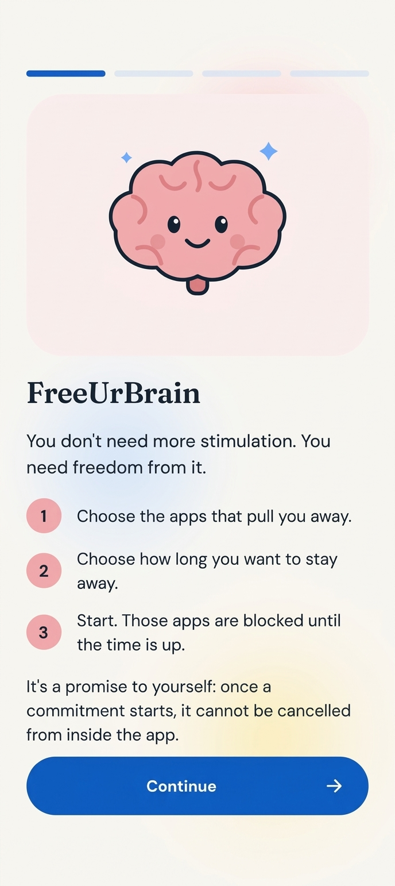
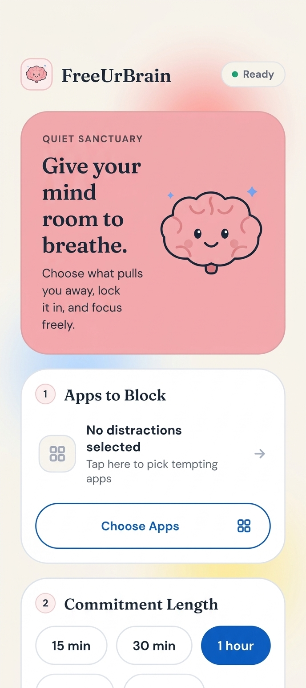
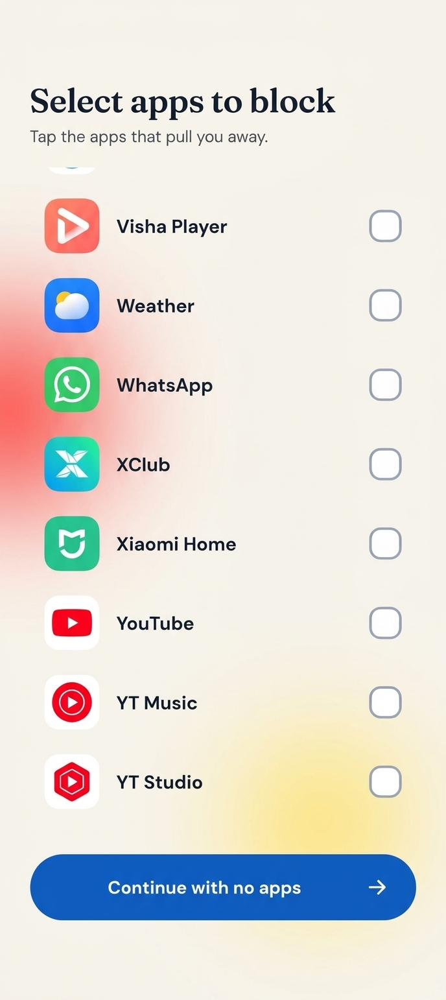
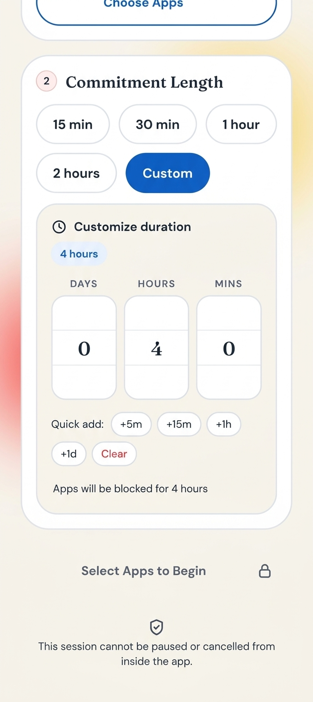
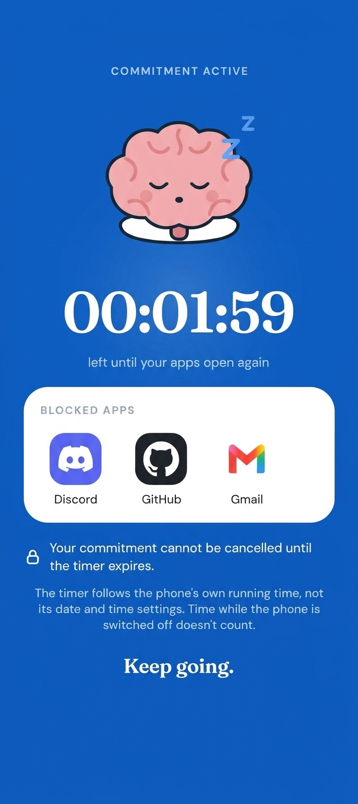
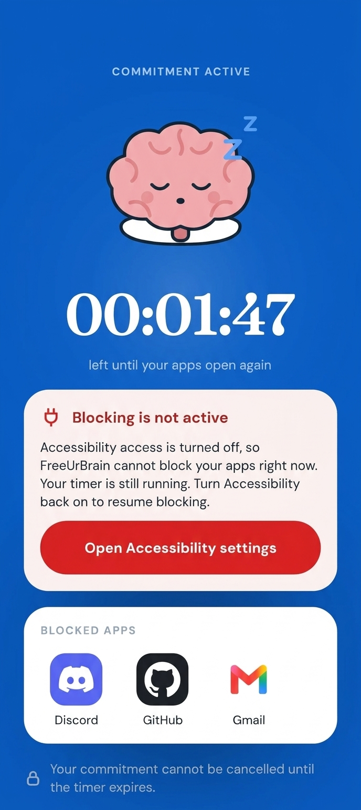
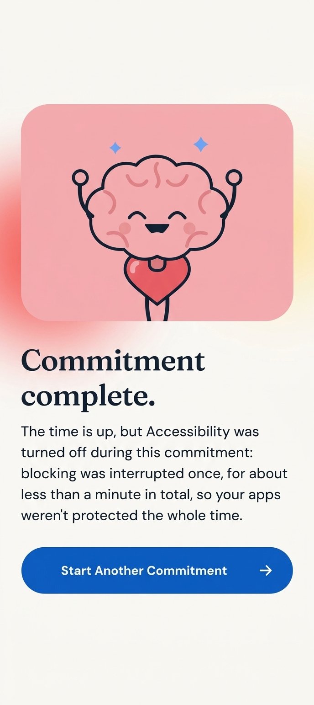
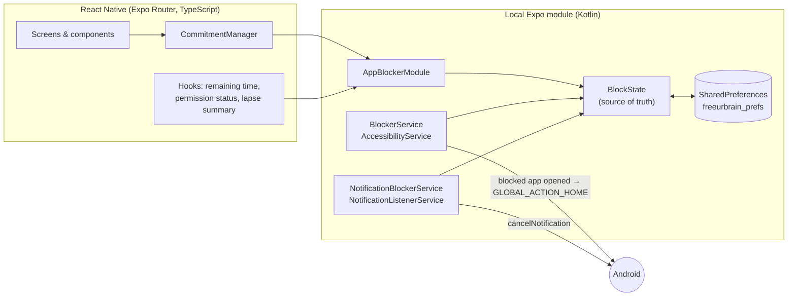

<div align="center">

<!-- Replace with your app icon: docs/screenshots/icon.png (512x512 recommended) -->


# FreeUrBrain

**A promise to yourself, enforced by your phone.**
Pick the apps that pull you away, choose how long to stay away, and start.
Until the timer ends, those apps (and their notifications) are blocked, and the commitment can't be cancelled from inside the app.


</div>

---

## Table of contents

- [Screenshots](#screenshots)
- [Why FreeUrBrain](#why-freeurbrain)
- [Features](#features)
- [How it works](#how-it-works)
- [Privacy](#privacy)
- [Permissions](#permissions)
- [Getting started](#getting-started)
- [Building a release](#building-a-release)
- [Project structure](#project-structure)
- [Design system](#design-system)
- [Testing](#testing)
- [Known limitations](#known-limitations)
- [Out of scope](#out-of-scope)
- [Contributing](#contributing)
- [License](#license)

---

## Screenshots

> Add your screenshots to `docs/` using the file names below, and they will show up here.
> Phone screenshots look best at about 1080×2400, saved as PNG.

<table>
  <tr>
    <td align="center"><b>Onboarding</b></td>
    <td align="center"><b>Home</b></td>
    <td align="center"><b>Choose apps</b></td>
    <td align="center"><b>Custom duration</b></td>
    <td align="center"><b>Active commitment</b></td>
    <td align="center"><b>Blocking is off warning</b></td>
    <td align="center"><b>Commitment complete</b></td>
  </tr>
  <tr>
    <td></td>
    <td></td>
    <td></td>
    <td></td>
    <td></td>
    <td></td>
    <td></td>
  </tr>
</table>

<!--
  Optional: a short screen recording of a full commitment (start → blocked app → complete).
  Save it as docs/screenshots/demo.gif and uncomment:

  <p align="center"></p>
-->

---

## Why FreeUrBrain

Most distraction blockers are easy to switch off the moment willpower runs low. FreeUrBrain is built around one idea: **a commitment should stay a commitment.** Once you start, there is no pause button and no cancel button inside the app.

It is also built to be small and honest:

- **No account, no backend, no analytics.** Everything stays on your device.
- **No gamification.** No streaks, points or rewards. Just a timer and a promise.
- **Honest about its limits.** If blocking was interrupted during a commitment, the completion screen says so instead of congratulating you.

---

## Features

| | |
|---|---|
| **App blocking** | Choose any installed apps. While a commitment runs, opening one sends you straight back to the home screen. |
| **Notification blocking** | Notifications from blocked apps are dismissed as they arrive, and the ones already in the shade are cleared when a commitment starts. |
| **Flexible duration** | Presets (15 min, 30 min, 1 hour, 2 hours) plus a **custom** duration, from 1 minute up to several days. |
| **Can't be cancelled** | No pause, no cancel, no edit of the app list while a commitment is active. |
| **Survives everything normal** | App closed, swiped away, phone restarted: the commitment and its remaining time are persisted natively and enforced again. |
| **Clock-manipulation resistant** | Time is measured with Android's monotonic clock, so changing the device date or time cannot shorten a commitment. |
| **Self-healing** | The app reconciles native and stored state on launch and whenever it returns to the foreground. |
| **Honest status** | If Accessibility or Notification access is turned off, the app shows a clear warning, and the completion screen reports how long blocking was interrupted. |
| **Real app icons** | Your blocked apps are shown with their real icons. |
| **Calm design** | A friendly brain mascot with four poses, a pink, blue and white identity, and only three subtle animations (all respecting Android's reduce-motion setting). |

---

## How it works

FreeUrBrain is an Expo (React Native) app with a small local Kotlin module that does the actual enforcement. **The native side is the source of truth**: blocking keeps working even if the React Native app is not running.



### Blocking apps

`BlockerService` is an `AccessibilityService` that listens only for `TYPE_WINDOW_STATE_CHANGED` events and reads the **package name** of the app coming to the foreground. If that package belongs to the active commitment, it performs `GLOBAL_ACTION_HOME`. It runs with `canRetrieveWindowContent=false`, so it cannot read what is on the screen.

It never blocks FreeUrBrain itself, system Settings or System UI, so you can always reach the settings to turn the permissions off. That is a deliberate choice: the app is a commitment tool, not a lock.

### Blocking notifications

`NotificationBlockerService` is a `NotificationListenerService`. When a notification is posted by a blocked app during a commitment, it calls `cancelNotification`. When the listener connects, or a commitment starts, it also sweeps the notifications already shown. It only inspects which app posted a notification and its key; it never reads, stores or forwards the content.

### Timekeeping

A commitment is stored as `{ id, packageNames, labels, durationMs }`. There is **no end timestamp**, because a wall-clock end time is exactly what a clock change would break. Instead, native code stores the *remaining time* and re-anchors it:

- Within a boot session, remaining time is computed with `SystemClock.elapsedRealtime()`, which the user cannot change.
- A checkpoint is saved every 60 seconds and on the `ACTION_SHUTDOWN` broadcast.
- Reboots are detected with `Settings.Global.BOOT_COUNT`. After a reboot the rule is **strict by default**: time while the phone is switched off does not count. This is one constant (`OFF_TIME_CREDIT_CAP_MS`) if you want to forgive short reboots.
- `startBlocking` is idempotent per commitment id, so a retry can never restart the clock.

### Interruptions

If the user turns Accessibility off mid-commitment, the service records the start of a *lapse* when Android unbinds it and closes it when it reconnects. The timer keeps running, the commitment screen shows a warning, and the completion message states how long blocking was interrupted.

---

## Privacy

- **Local-first.** No servers, no accounts, no analytics, no telemetry.
- **Release builds ship without the `INTERNET` permission** (see [Building a release](#building-a-release)), so the app cannot send data anywhere even if it wanted to.
- `allowBackup` is off, so your selections are not copied into cloud backups.
- The Accessibility service only sees which app is in the foreground. The notification service only sees which app posted a notification. Neither reads, stores or sends the content of your screen or your notifications.

---

## Permissions

| Permission | Why | How it's granted |
|---|---|---|
| **Accessibility service** | To notice when a blocked app comes to the foreground and send you home. | The user enables it in Android settings. |
| **Notification access** | To dismiss notifications from blocked apps during a commitment. | The user enables it in Android settings. |

The app lists installed apps with `<queries>` declarations for launcher and home intents. It does **not** request `QUERY_ALL_PACKAGES`.

> **Sideloaded release APKs on Android 13+:** the system may grey out Accessibility or Notification access for apps installed outside the Play Store. The user opens the app's *App info* page, taps the ⋮ menu and chooses **Allow restricted settings**. Builds installed with `npx expo run:android` are not affected.

---

## Getting started

FreeUrBrain uses a **local native module**, so it does **not** run in Expo Go. You need a development build on a real Android device (Accessibility services can't be tested on most emulators the way they behave on a phone).

### Prerequisites

- Node.js 18 or newer
- JDK 17
- Android Studio with the Android SDK and platform tools (`adb`)
- An Android phone with USB debugging enabled

### Run it

```bash
git clone https://github.com/AmineZhioua/free-ur-brain.git
cd FreeUrBrain
npm install

# Build the native project and install a development build on your connected phone
npx expo run:android
```

After the first build, start Metro with `npx expo start` and open the installed app.

On first launch the onboarding walks you through the two permissions. You can also enable them later from the Home screen, but a commitment can't start without them.

### Handy development tips

- **Short durations:** development builds (`__DEV__`) add 1-minute and 3-minute presets so you can test expiry quickly. They are not included in release builds.
- **Reset onboarding or all data:** `adb shell pm clear com.freeurbrain.app` clears everything (Android may switch Accessibility off for the app afterwards).
- **Native logs:** `adb logcat -s FreeUrBrain` shows blocking, notification dismissal and service connect/disconnect events.
- **After changing native code or `app.json`:** rebuild with `npx expo run:android`. If something looks stale, run `npx expo prebuild --clean --platform android` first.
- **Native module name:** the TypeScript `requireNativeModule('AppBlockerModule')` string must exactly match the `Name("AppBlockerModule")` line in `AppBlockerModule.kt`. If you see *"Cannot find native module"*, check this first.

---

## Building a release

Release builds strip the network permissions so the "no internet" promise is enforced by the manifest, not just by the code.

```bash
# 1. Generate the native project with network permissions blocked
FUB_RELEASE=1 npx expo prebuild --clean --platform android

# 2. Build the APK
cd android
./gradlew assembleRelease

# 3. Verify the permissions of the result
aapt2 dump permissions app/build/outputs/apk/release/app-release.apk
```

The `FUB_RELEASE=1` flag is read by `app.config.js`, which adds `blockedPermissions` (such as `INTERNET`) to the Android config. The `aapt2` output should not list `android.permission.INTERNET`.

> Before publishing, configure your own signing keystore. Don't ship a build signed with the debug key.

---

## Project structure

```
FreeUrBrain/
├── app.json                      # Expo config (package: com.freeurbrain.app, allowBackup: false)
├── app.config.js                 # Release hardening (FUB_RELEASE=1 blocks network permissions)
├── assets/                       # App icon, adaptive icon, splash
├── docs/             # README screenshots
├── modules/app-blocker/          # Local Expo module (Kotlin), autolinked
│   ├── expo-module.config.json
│   ├── src/                      # TypeScript bindings (requireNativeModule)
│   └── android/src/main/
│       ├── AndroidManifest.xml   # Both services + <queries>
│       ├── res/xml/              # Accessibility service config
│       └── java/expo/modules/appblocker/
│           ├── AppBlockerModule.kt            # JS ↔ native bridge
│           ├── BlockState.kt                  # Source of truth: packages, time, lapses
│           ├── BlockerService.kt              # AccessibilityService: blocks apps
│           ├── NotificationBlockerService.kt  # NotificationListenerService: blocks notifications
│           └── Prefs.kt                       # SharedPreferences shared by JS and services
└── src/
    ├── app/                      # Expo Router screens: index, apps, commitment, onboarding
    ├── components/               # Button, Screen, BrainFigure, Icon, AppIcon, DurationSelector, …
    ├── core/
    │   ├── commitment/           # CommitmentManager, time helpers, duration options
    │   ├── selection/            # Selected-apps persistence
    │   ├── onboarding/           # Onboarding flag
    │   ├── storage/              # Typed JSON storage over the native store
    │   └── models/               # InstalledApp, Commitment, LapseSummary
    ├── hooks/                    # useCommitment, useRemainingTime, useAccessibilityStatus,
    │                             # useNotificationAccess, useLapseSummary, useAppIcons
    ├── native/                   # Thin typed wrapper around the native module
    └── theme.ts                  # All design tokens (colors, fonts, spacing, motion)
```

**Principles the code follows**

- Business logic lives in `src/core` and hooks, never inside screens.
- Native code is the source of truth for blocking; JavaScript reads and requests, it does not enforce.
- Commitment operations are serialized so that two quick taps can't race.
- Every failure path shows a message instead of crashing or silently doing nothing.

---

## Design system

The whole UI is driven by tokens in `src/theme.ts`. Components never hard-code a colour, font or size.

| Token | Hex | Used for |
|---|---|---|
| Brain pink | `#F2AEB1` | The mascot, hero cards |
| Deep blue | `#0A5CC4` | Actions, selection, the active-commitment screen |
| White | `#FFFFFF` | Base background |
| Ink | `#0B1F3F` | Text and the mascot outline |

- **Typography:** Fraunces SemiBold (roman only) for headlines, DM Sans for everything else.
- **Mascot:** a flat, outlined brain with four poses: *awake* (ready), *asleep* (a commitment is running), *happy* (completed) and *unplugged* (a permission is off). It is drawn as SVG (`react-native-svg`), so you can replace `BrainFigure.tsx` with your own artwork and keep the same four poses.
- **Motion:** exactly three kinds (a slow breathing loop, a short fade-and-rise on entry, a small selection pop), all disabled when Android's reduce-motion is on.
- **Pink is never used for text**, because it is too light on white.

---

## Testing

There is no automated UI test suite yet. Enforcement is native and device-dependent, so the project ships with a manual checklist. Run it on a real phone before every release.

**Blocking**
- [ ] Start a short commitment with a few apps. Opening each one sends you home.
- [ ] Apps you did **not** select open normally.
- [ ] FreeUrBrain and Android Settings always open.
- [ ] After the timer ends, blocked apps open again.

**Notifications**
- [ ] A notification from a blocked app disappears shortly after it arrives.
- [ ] Notifications already in the shade are cleared when the commitment starts.
- [ ] Notifications from other apps are untouched.

**Persistence**
- [ ] Swipe the app away from recents. Blocking continues, and reopening shows the right time left.
- [ ] Restart the phone. Blocking resumes (time while it was off does not count).
- [ ] Change the device date/time. The remaining time does not change.

**Permissions and honesty**
- [ ] With Accessibility off, Start is disabled and the Home screen explains why.
- [ ] With Notification access off, Start is disabled and a card explains why.
- [ ] Turning Accessibility off during a commitment shows a warning, and the completion screen reports the interruption.

**UI**
- [ ] Custom duration accepts days, hours and minutes, and rejects less than 1 minute.
- [ ] Long labels (for example "Commit for 3 days 4 hours 4 minutes") don't overflow.
- [ ] Everything works with Android's largest font size and with reduce-motion on.

---

## Known limitations

FreeUrBrain is a **personal commitment tool, not a lock.** By design it can't resist someone determined to get out, and it says so in the onboarding. Accepted ways to end blocking early:

- Turning off the Accessibility service or Notification access in Android settings (the app detects this and warns, but cannot prevent it)
- Force-stopping or uninstalling the app
- Clearing the app's data
- A rooted device

Other things worth knowing:

- **Notifications can flash.** Android only lets a listener dismiss a notification after it is posted, so a heads-up banner or sound may appear for a moment before it is removed.
- **Dismissed notifications are gone.** They are not delivered again after the commitment ends.
- **Ongoing notifications can't be removed** (for example a media player or a foreground service).
- **Some manufacturers aggressively stop background services.** If blocking stops working, allow FreeUrBrain to run without battery restrictions (the onboarding links to this setting).
- **Android only.** There is no iOS version.

---

## Out of scope

These are deliberately not part of the MVP: iOS, Device Owner / kiosk mode, VPN or website blocking, scheduled recurring commitments, streaks and other gamification, accounts, cloud sync and analytics. Ideas are welcome, but the project aims to stay small and local-first.

---

## Contributing

Contributions are welcome.

1. Fork the repo and create a branch: `git checkout -b feature/my-change`
2. Keep the principles above: native is the source of truth, no network, no tracking, honest copy.
3. Run the [manual checklist](#testing) for anything that touches blocking, timing or permissions.
4. Open a pull request that explains **what** changed and **why**, with screenshots for UI changes.

Please open an issue first for larger changes (new permissions, new dependencies, anything that touches the privacy promises).

**Reporting a bug:** include your Android version, phone model, whether the permissions were granted, and the output of `adb logcat -s FreeUrBrain`.

---

## License

Released under the [MIT License](LICENSE).